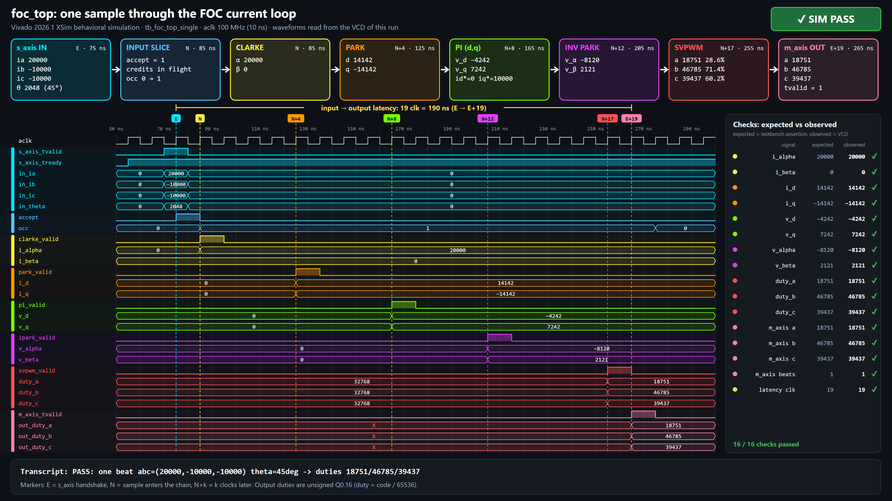

# FOC Motor Control — Vivado IP

A field-oriented control (FOC) current loop for PMSM/BLDC motors, written in SystemVerilog and packaged as a Vivado IP (`user.org:user:foc_motor_control:1.0`).

```
s_axis (ia, ib, ic, theta)
  -> register slice -> Clarke -> Park -> PI (d) / PI (q) -> inverse Park -> SVPWM
  -> output FIFO -> m_axis (duty_a, duty_b, duty_c)
```

- AXI4-Stream in and out, with registered `tready`, `tvalid` and `tdata`
- One sample per clock with `m_axis_tready` held high. Under backpressure no sample is lost: a credit counter admits a sample only when the output FIFO is guaranteed to have room for it.
- 19-clock latency from the `s_axis` handshake to `m_axis_tvalid`
- No vendor IP cores: sin/cos comes from a quarter-wave block-RAM table (`rtl/sin_table.mem`)

## Verification evidence: one sample through the loop

[`tb/tb_foc_top_single.sv`](tb/tb_foc_top_single.sv) sends exactly one AXI-Stream beat into `foc_top` and asserts the output of every stage. The run below used Vivado 2026.1 XSim (behavioral) on 2026-11-16. All evidence is in [`verification_evidence/`](verification_evidence/).



▶ **[Walkthrough video (62 s)](verification_evidence/04_foc_single_sample_dataflow_walkthrough.mp4)**: a time cursor sweeps the waveform, each stage lights up in the clock cycle its result becomes valid, and a caption explains each step.

**Stimulus:** ia = 20000, ib = −10000, ic = −10000, theta = 2048 (45°), id_ref = 0, iq_ref = 10000, Kp = 0.25, Ki = 0.05, `aclk` = 100 MHz.

| Stage | Cycle | Clock edge | Observed output (= testbench expected value) |
|---|---|---|---|
| `s_axis` handshake | E | 75 ns | sample captured by the input register slice |
| Credit check, Clarke | N = E+1 | 85 ns | `accept` = 1; α = 20000, β = 0 |
| Park | N+4 | 125 ns | d = 14142, q = −14142 |
| PI (d, q) | N+8 | 165 ns | v_d = −4242, v_q = 7242 |
| Inverse Park | N+12 | 205 ns | v_α = −8120, v_β = 2121 |
| SVPWM | N+17 | 255 ns | duty a / b / c = 18751 / 46785 / 39437 (28.6 % / 71.4 % / 60.2 %) |
| `m_axis` | E+19 | 265 ns | `m_axis_tvalid` = 1 with the same duties; exactly one output beat |

Input-to-output latency is **19 clocks = 190 ns at 100 MHz**. All 16 checks match (14 stage values, the beat count and the latency), and the simulator prints:

```
PASS: one beat abc=(20000,-10000,-10000) theta=45deg -> duties 18751/46785/39437
$finish called at time : 340 ns
```

| File | Content |
|---|---|
| [`00_foc_single_sample_dataflow_annotated.png`](verification_evidence/00_foc_single_sample_dataflow_annotated.png) | Annotated data-flow figure (above), rendered from the VCD of this run |
| [`01_vivado_xsim_input_side_E_to_N.png`](verification_evidence/01_vivado_xsim_input_side_E_to_N.png) | Vivado waveform: `s_axis` beat, input slice / credit counter, Clarke |
| [`02_vivado_xsim_park_pi_invpark.png`](verification_evidence/02_vivado_xsim_park_pi_invpark.png) | Vivado waveform: Park, PI, inverse Park |
| [`03_vivado_xsim_svpwm_to_m_axis.png`](verification_evidence/03_vivado_xsim_svpwm_to_m_axis.png) | Vivado waveform: SVPWM and `m_axis` output |
| [`04_foc_single_sample_dataflow_walkthrough.mp4`](verification_evidence/04_foc_single_sample_dataflow_walkthrough.mp4) | Walkthrough video (H.264, 1920×1080) |
| [`05_xsim_simulate.log`](verification_evidence/05_xsim_simulate.log) | XSim transcript with the per-stage `STAGE` lines and the `PASS` line |
| [`06_foc_single_dataflow.vcd`](verification_evidence/06_foc_single_dataflow.vcd) | Value-change dump of the 33 data-flow signals the figure and video are drawn from |

Notes for reading the waveforms:
- Each stage's `*_valid` strobe is high for exactly one clock while its result is new. Its data registers keep the value afterwards.
- `duty_a/b/c` show 32768 (50 %) before the sample arrives; that is the SVPWM reset value.
- `m_axis_tdata` is X until the first write into the output FIFO, because the FIFO RAM is not initialized in simulation. That is legal on AXI-Stream while `m_axis_tvalid` is low.

## Implementation results

Target: **xczu7ev-ffvc1156-2-e** (AMD ZCU106), **100 MHz**, Vivado 2026.1, out-of-context synthesis and implementation (place and route). Full reports are in [`reports/`](reports/).

The IP is implemented inside a timing harness, [`impl/foc_top_timing_top.sv`](impl/foc_top_timing_top.sv), that adds only boundary registers, so every IP path, including the AXI handshake logic, is timed register to register. The numbers below are for the IP instance alone (`dut`), taken from the hierarchical reports.

### Timing (post-route), from [`timing_summary.rpt`](reports/timing_summary.rpt)

| Metric | Value |
|---|---|
| Clock | `aclk`, 10.000 ns (100 MHz) |
| WNS (setup) | **+5.168 ns**, 0 failing endpoints out of 4234 |
| WHS (hold) | +0.012 ns, 0 failing endpoints |
| WPWS (pulse width) | +4.458 ns |
| Worst path | `u_in_slice/m_data_reg` → `u_clarke/i_alpha_reg`: 4.613 ns, 13 logic levels (through a DSP48E2) |

*All user specified timing constraints are met.*

### Resources (post-route), from [`utilization_hier.rpt`](reports/utilization_hier.rpt)

| Resource | IP (`dut`) | Device total | % |
|---|---|---|---|
| CLB LUTs | 1152 (1115 logic, 28 LUTRAM, 9 SRL) | 230400 | 0.50 |
| CLB registers | 765 | 460800 | 0.17 |
| Block RAM (RAMB36) | 4 | 312 | 1.28 |
| DSP48E2 | 16 | 1728 | 0.93 |
| URAM | 0 | 96 | 0 |

Breakdown by block: SVPWM 355 LUT / 2 DSP · Clarke+Park+2×PI 506 LUT / 2 BRAM / 10 DSP · inverse Park 123 LUT / 2 BRAM / 4 DSP · input slice 84 LUT · output FIFO 72 LUT.

### Power (post-route), from [`power.rpt`](reports/power.rpt)

| Metric | Value |
|---|---|
| IP dynamic power (`dut`) | **0.042 W** |
| Device static power (whole ZU7EV, not the IP) | 0.592 W |
| Total on-chip (harness + device static) | 0.635 W |
| Junction temperature | 25.6 °C |

The power figure is a vectorless estimate (Vivado default toggle rates, confidence "Medium"). For a more accurate figure, use a SAIF file from simulation of your actual operating point.

### Checks

- DRC ([`drc.rpt`](reports/drc.rpt)): 0 errors. 12 advisory warnings, which are DSP pipelining hints and one unused harness net.
- Methodology ([`methodology.rpt`](reports/methodology.rpt)): 4 `SYNTH-6` warnings, which note that the sine ROM output register is not merged into the BRAM. They are harmless at 100 MHz with 5.2 ns of slack.
- Behavioural simulation (xsim): `tb/tb_foc_top.sv` checks every stage on every sample (33,500+ samples). Clarke and Park are compared against a real-valued reference; PI, inverse Park and SVPWM must match bit-exact models. It also checks AXI ordering, no loss under backpressure, exact latency and full throughput (16384 beats in 16384 clocks). Result: `PASS: foc_top (Clarke+Park+PI+invPark+SVPWM, AXI-Stream) regression`.
- Single-sample walkthrough (xsim): `tb/tb_foc_top_single.sv` asserts every stage output and the final `m_axis` beat for one known sample. Result: `PASS: one beat abc=(20000,-10000,-10000) theta=45deg -> duties 18751/46785/39437`. See [Verification evidence](#verification-evidence-one-sample-through-the-loop).
- Packaged-IP check: the IP was added to a fresh project from this folder as an IP repository and synthesized OOC with 0 errors and 0 warnings. `sin_table.mem` was read successfully; the result was 765 FF, 4 BRAM, 16 DSP.

## Using the IP

1. Clone this repo.
2. In Vivado: **Settings → IP → Repository → +** and add the cloned folder (it contains `component.xml`). From Tcl:
   ```tcl
   set_property ip_repo_paths /path/to/foc_motor_control [current_project]
   update_ip_catalog
   ```
3. Add **FOC Motor Control** from the IP catalog or the block design. Connect `s_axis`/`m_axis` and `aclk`/`aresetn` as usual. The control inputs are plain ports.

### Ports

| Port | Dir | Width | Description |
|---|---|---|---|
| `aclk` | in | 1 | Clock (both AXI-Stream interfaces) |
| `aresetn` | in | 1 | Synchronous active-low reset. Discards samples in flight and clears the PI integrators. |
| `s_axis_tdata` | in | 64 | `[15:0]` ia, `[31:16]` ib, `[47:32]` ic (signed Q1.15); `[61:48]` theta (unsigned, 2^14 = one electrical turn); `[63:62]` unused |
| `s_axis_tvalid` / `s_axis_tready` | in / out | 1 | AXI4-Stream handshake |
| `m_axis_tdata` | out | 48 | `[15:0]` duty_a, `[31:16]` duty_b, `[47:32]` duty_c (unsigned Q0.16, duty = code / 65536) |
| `m_axis_tvalid` / `m_axis_tready` | out / in | 1 | AXI4-Stream handshake |
| `id_ref`, `iq_ref` | in | 17 | Signed d/q current set-points, same format as the Park outputs (15 fractional bits) |
| `kp_d`, `ki_d`, `kp_q`, `ki_q` | in | 18 | Unsigned PI gains, value = code / 2^14. `ki` is the per-sample gain (Ki·Ts). |
| `u_limit` | in | 16 | Magnitude limit for the d/q voltage outputs. It also clamps the integrator (anti-windup). |

The control inputs are quasi-static. Each one is sampled when the matching sample reaches the PI stage. See the header comments in [`rtl/foc_top.sv`](rtl/foc_top.sv) and [`rtl/pi_controller.sv`](rtl/pi_controller.sv) for exact number formats and behaviour.

### Parameters

| Parameter | Default | Options | Description |
|---|---|---|---|
| `FIFO_DEPTH` | 32 | 8, 16, 32, 64 | Output FIFO depth (distributed RAM) |

The data widths are fixed by the `tdata` packing and the sine table. Only the default `FIFO_DEPTH = 32` was simulated and implemented.

## Reproducing the results

Run each command from the repo root with Vivado on `PATH`. Outputs go to `build/` (git-ignored); the reports are written to `reports/`.

```sh
vivado -mode batch -source scripts/run_sim.tcl                              # regression testbench
vivado -mode batch -source scripts/run_sim.tcl -tclargs tb_foc_top_single   # single-sample walkthrough
vivado -mode batch -source scripts/build.tcl                                # OOC synth + impl + reports
vivado -mode batch -source scripts/package_ip.tcl                           # re-package the IP
```

`scripts/build.tcl` takes an optional part: `-tclargs <part>`. If you change the vendor, library or version, edit the variables at the top of `scripts/package_ip.tcl`. To regenerate the sine table, run `python scripts/gen_sin_table.py`.

The single-sample run prints one `STAGE` line per pipeline stage and ends with the `PASS` line shown in [Verification evidence](#verification-evidence-one-sample-through-the-loop). To view it as a waveform in the Vivado GUI, add `rtl/*.sv`, `rtl/sin_table.mem` and `tb/tb_foc_top_single.sv` to a project, set `tb_foc_top_single` as the simulation top, and run `launch_simulation`.

**Troubleshooting (Windows):** if `launch_simulation` fails with `'compile.bat' is not recognized as an internal or external command`, the environment variable `NoDefaultCurrentDirectoryInExePath` is set in the shell that started Vivado. It stops `cmd.exe` from running scripts in the simulation folder. Clear it for the session (`unset ::env(NoDefaultCurrentDirectoryInExePath)` in the Vivado Tcl console) and launch again.

## Repository layout

```
component.xml, xgui/   Vivado IP definition (generated by scripts/package_ip.tcl)
rtl/                   IP sources
  foc_motor_control.v    IP top (Verilog-2001 wrapper, required by the IP packager)
  foc_top.sv             AXI-Stream FOC datapath
  clarke_park_pi.sv, clarke_transform.sv, park_transform.sv, pi_controller.sv,
  inv_park_transform.sv, svpwm.sv, sincos_lut.sv, axis_skid_buffer.sv, axis_fifo.sv
  sin_table.mem          quarter-wave sine ROM contents
tb/                    self-checking testbenches (xsim)
impl/                  OOC timing harness + constraints used for the results above
scripts/               build, simulation, packaging and table-generation scripts
reports/               post-route timing, utilization, power, DRC and methodology reports
verification_evidence/ single-sample simulation evidence: annotated figure, Vivado waveforms,
                       walkthrough video, XSim transcript and VCD
```

## License

**Proprietary, all rights reserved.** Copyright (c) 2026 Sourya Dasgupta.

This repository is published for viewing only. You may read it on GitHub, but you may not copy, modify, synthesize, use in any design or product, redistribute, or use it to train AI systems without written permission. See [`LICENSE`](LICENSE) for the full terms. For licensing enquiries, contact souryadasgupta2001@gmail.com.
